# P3–P4 · 画风与收藏空间参考

归档于 2026-10-21。收录本线程已明确讨论的 6 组创作者／空间参考，共 8 条参考记录、14 个图像文件。馆方网页图按下载字节保留；尺寸和校验值见 [图片清单](image-manifest.json)。

**状态为研究参考，不是设计定稿。当前柜体／书册框架和线上预览不因本次归档变更。**

[产品参考库首页](../README.md) · [结构化索引](references.json) · [浏览拼板](contact-sheet.jpg)

## 使用边界

- P1/P2继续作为项目内的画法、线宽层级、疏密和秩序基准；不复制P1的主体元素。
- 这些参考分别用于局部线条组织、器物造型和收藏空间关系，不能合并成一个笼统的“华丽风格”。
- 对比由大形／细纹、长线／短线、疏处／密处共同建立，不等同于加黑块或整体减细。
- 新插画与新排版必须单独存放，用户确认并要求替换后再更新基线。

## 参考索引

| 参考 | 主要用途 |
|---|---|
| [Jessie Marion King · The Defence of Guenevere and Other Poems 插画（1904）](#king) | 看细柱、弧线、垂饰和局部纹样怎样承担不同作用；长线之间保留连续空隙。 |
| [Alphonse Mucha · Documents décoratifs，第33版百合线稿（1901–1902）](#mucha-lilies) | 先读舒展的大形，再读花心、交叠叶片的细纹；对比来自大小、长短和疏密共同组织。 |
| [Alphonse Mucha · Byzantine Heads（1897）](#mucha-heads) | 观察主体越过圆框时，主体和外围装饰怎样产生联系；这是平面构图关系的参考。 |
| [Alphonse Mucha · Planche pour les documents décoratifs lampes-fleurs, et suspension](#mucha-lamps) | 花瓣参与灯罩造型，枝干参与支撑；研究装饰如何成为器物的结构。 |
| [Aubrey Beardsley · The Peacock Skirt](#beardsley) | 大轮廓先成立，细纹依附轮廓展开；学习黑白空间和纹样的组织。 |
| [Harry Clarke · 黑白书籍插画；补核实例 Faust—Opening Illustration](#clarke) | 观察不同纹样、长线和暗部的穿插；同时作为过高密度的边界参照。 |
| [Carlo Bugatti · Desk and chair，约1900；RISD Museum](#bugatti) | 看大圆盘、细柱、斜腿、阶梯边缘和垂饰的尺度差异，以及装饰与支撑的关系。 |
| [James McNeill Whistler／孔雀厅 · The Peacock Room：空架整体与层板细部](#peacock) | 看墙面、门洞、架子与收藏品怎样共同构成收藏空间；空架照片便于观察层板节奏和留空。 |

## Jessie Marion King · The Defence of Guenevere and Other Poems 插画（1904）

[来源页面](https://university-collections.wp.st-andrews.ac.uk/2013/03/19/52-weeks-of-inspiring-illustrations-week-39-jessie-m-king-william-morriss-the-defence-of-guenevere-1904/)

**看什么**　看细柱、弧线、垂饰和局部纹样怎样承担不同作用；长线之间保留连续空隙。

**控制边界**　不把所有构件都画成同一种双线卷曲，也不照搬人物与场景。

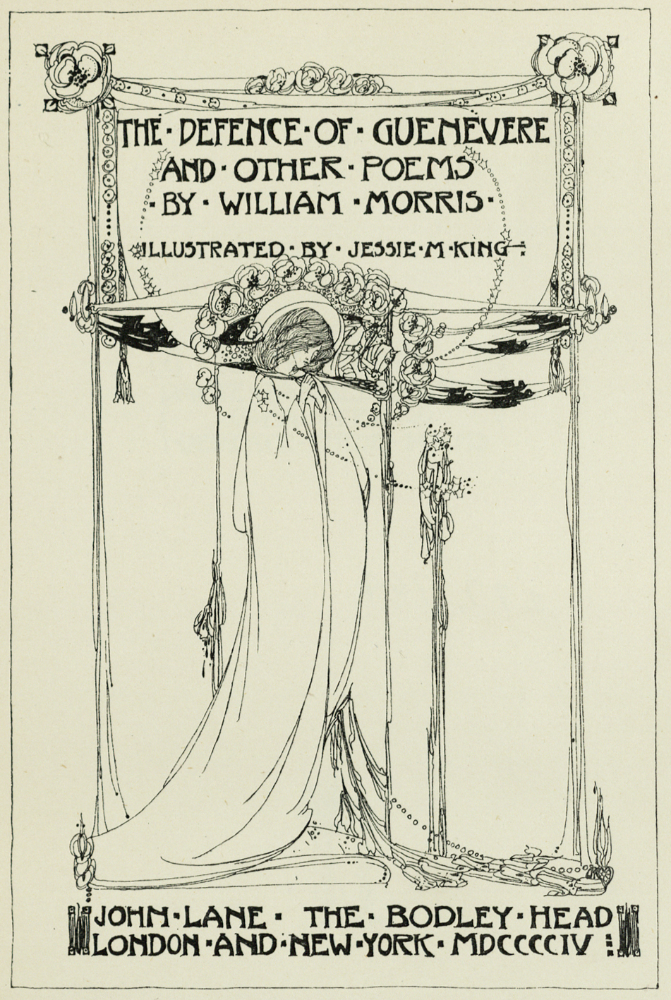

文件 [images/king-titlepage.jpg](images/king-titlepage.jpg)。

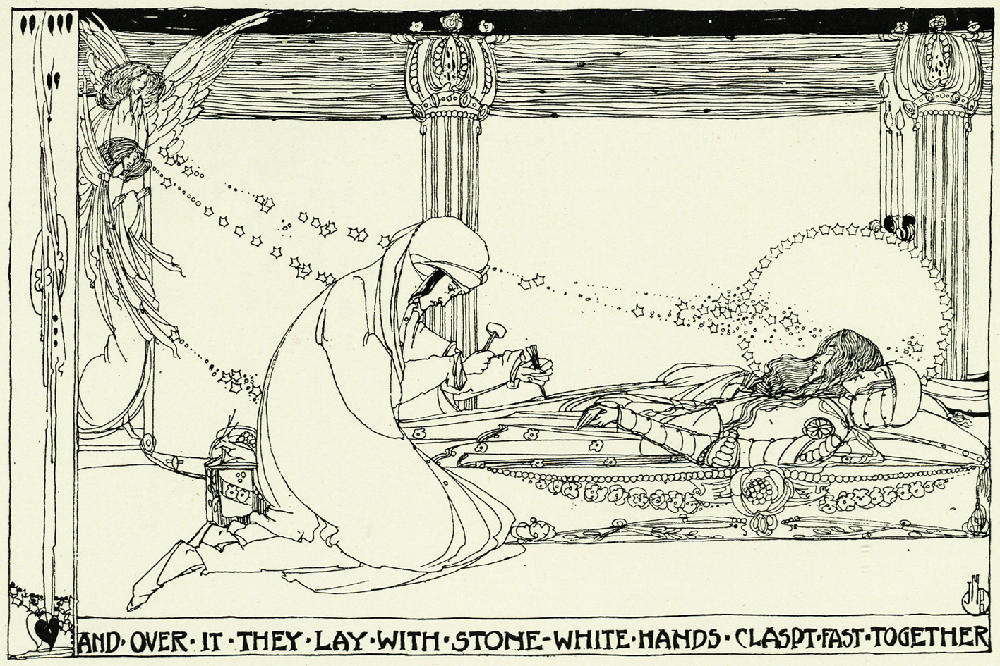

文件 [images/king-claspt.jpg](images/king-claspt.jpg)。

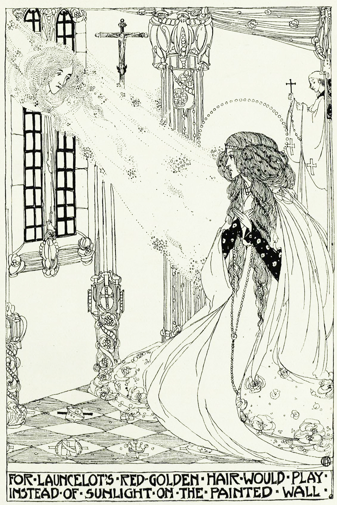

文件 [images/king-golden-hair.jpg](images/king-golden-hair.jpg)。

## Alphonse Mucha · Documents décoratifs，第33版百合线稿（1901–1902）

[来源页面](https://www.muchafoundation.org/en/gallery/browse-works/object/106/)

**看什么**　先读舒展的大形，再读花心、交叠叶片的细纹；对比来自大小、长短和疏密共同组织。

**控制边界**　不靠另加一条实黑花带来代替整体主次，也不直接复制百合元素。

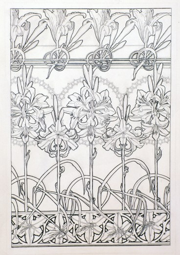

文件 [images/mucha-lilies-plate33.jpg](images/mucha-lilies-plate33.jpg)。

## Alphonse Mucha · Byzantine Heads（1897）

[来源页面](https://www.muchafoundation.org/en/gallery/browse-works/object/240/)

**看什么**　观察主体越过圆框时，主体和外围装饰怎样产生联系；这是平面构图关系的参考。

**控制边界**　不将圆框、人像或配色当作P3必须采用的元素。

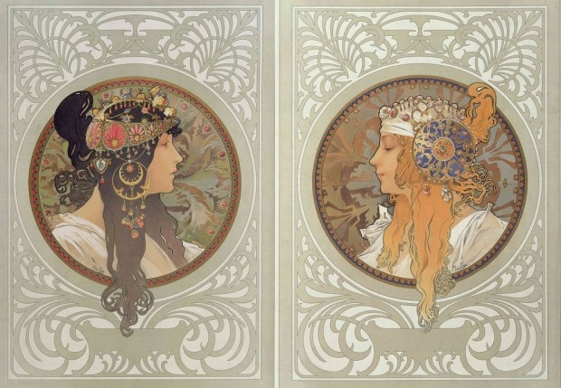

文件 [images/mucha-byzantine-heads.jpg](images/mucha-byzantine-heads.jpg)。

## Alphonse Mucha · Planche pour les documents décoratifs lampes-fleurs, et suspension

[来源页面](https://www.musee-orsay.fr/en/artworks/planche-pour-les-documents-decoratifs-lampes-fleurs-et-suspension-242836)

**看什么**　花瓣参与灯罩造型，枝干参与支撑；研究装饰如何成为器物的结构。

**控制边界**　不把植物当作贴在矩形外侧的一圈花边，也不照搬素描明暗。

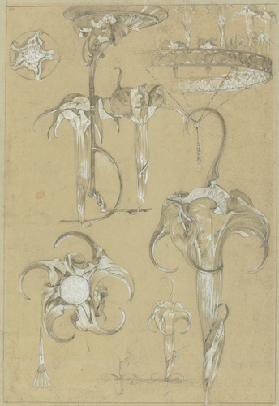

文件 [images/mucha-flower-lamps.jpg](images/mucha-flower-lamps.jpg)。

## Aubrey Beardsley · The Peacock Skirt

[来源页面](https://www.vam.ac.uk/articles/aubrey-beardsley-decadence-desire)

**看什么**　大轮廓先成立，细纹依附轮廓展开；学习黑白空间和纹样的组织。

**控制边界**　不能简化成“某处涂黑就有对比”。

文件为Wikimedia的SVG复刻版本，非馆方原作扫描。

[补充出处](https://www.metmuseum.org/art/collection/search/822344)

[补充出处](https://commons.wikimedia.org/wiki/File:Beardsley-peacockskirt.svg)

文件 [images/beardsley-peacock-skirt.svg](images/beardsley-peacock-skirt.svg)。

## Harry Clarke · 黑白书籍插画；补核实例 Faust—Opening Illustration

[来源页面](https://www.oldbookillustrations.com/illustrations/opening-faust/)

**看什么**　观察不同纹样、长线和暗部的穿插；同时作为过高密度的边界参照。

**控制边界**　不可照搬其总体密度；P1/P2的疏密与秩序仍是项目基准。

本轮原讨论只确认到作者与黑白插画方向；本图为归档时补核的可追溯实例，未证实与此前展示的具体图完全相同。

[补充出处](https://www.nationalgallery.ie/explore-and-learn/new-acquisitions/harry-clarke)

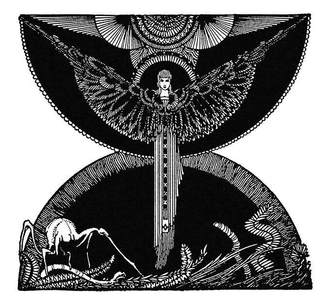

文件 [images/clarke-faust-opening.jpg](images/clarke-faust-opening.jpg)。

## Carlo Bugatti · Desk and chair，约1900；RISD Museum

[来源页面](https://risdmuseum.org/manual/357_more_is_more_the_inimitable_designs_of_carlo_bugatti)

**看什么**　看大圆盘、细柱、斜腿、阶梯边缘和垂饰的尺度差异，以及装饰与支撑的关系。

**控制边界**　只参考器物造型变化，不带入摄影材质、3D厚度或整件家具的复杂程度。

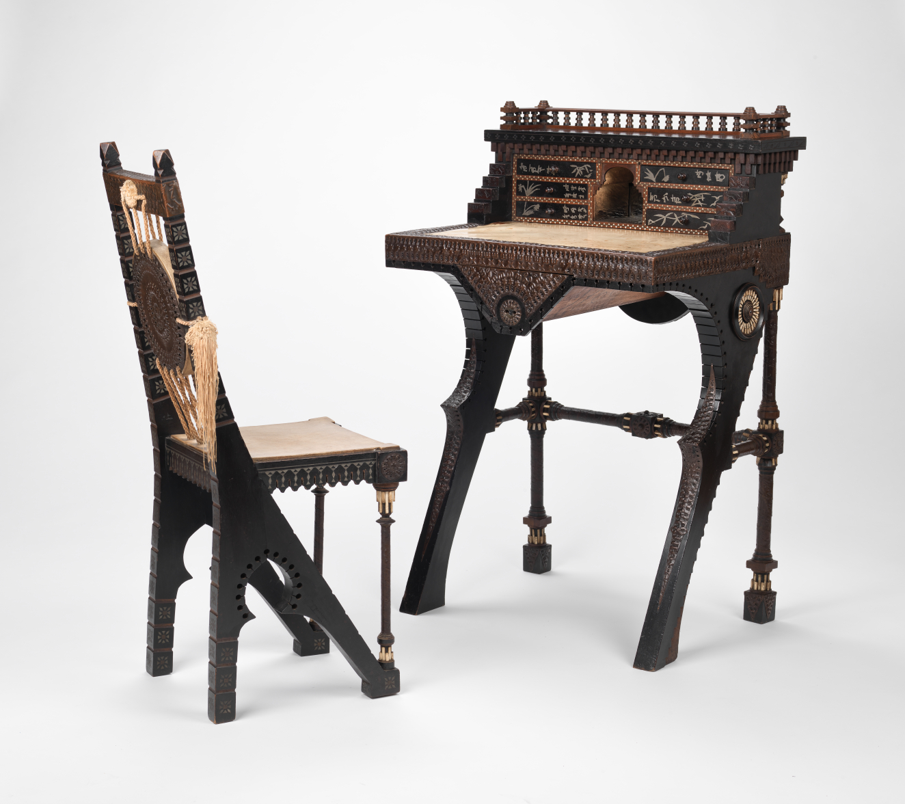

文件 [images/bugatti-desk-chair.jpg](images/bugatti-desk-chair.jpg)。

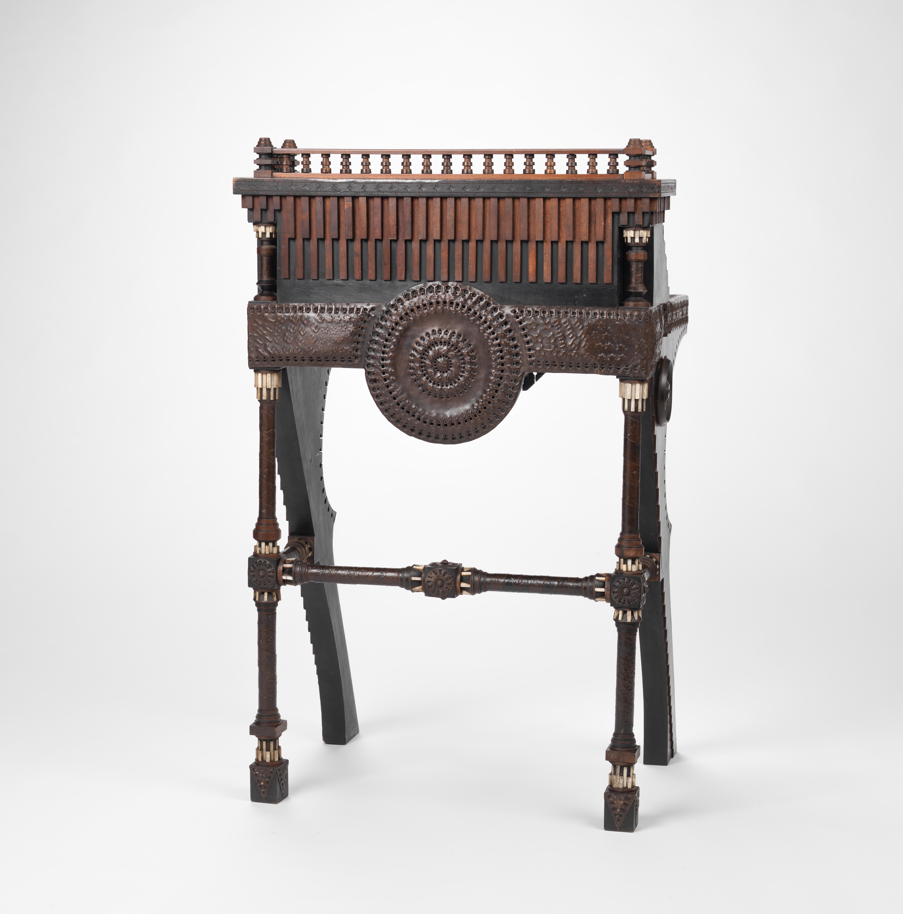

文件 [images/bugatti-detail-01.jpg](images/bugatti-detail-01.jpg)。

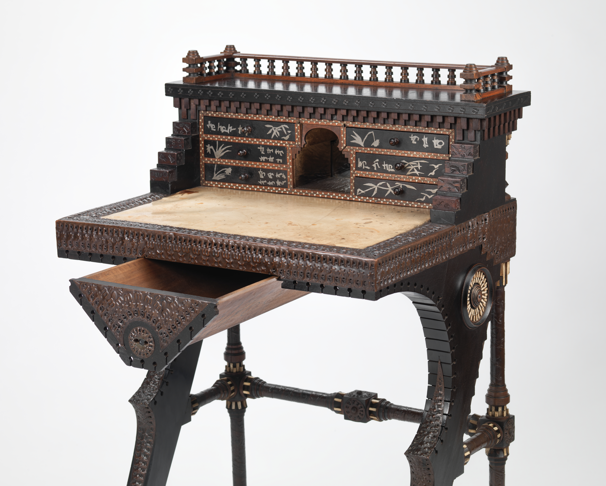

文件 [images/bugatti-detail-02.jpg](images/bugatti-detail-02.jpg)。

## James McNeill Whistler／孔雀厅 · The Peacock Room：空架整体与层板细部

[来源页面](https://asia.si.edu/whats-on/exhibitions/the-peacock-room-in-blue-and-white/)

**看什么**　看墙面、门洞、架子与收藏品怎样共同构成收藏空间；空架照片便于观察层板节奏和留空。

**控制边界**　空间组织可借鉴，配色、摄影光影和实景材质不直接迁入P3。

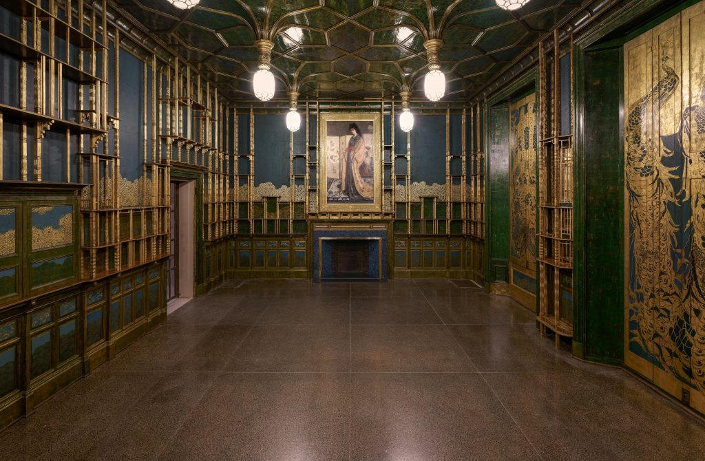

文件 [images/peacock-north-wall.jpg](images/peacock-north-wall.jpg)。

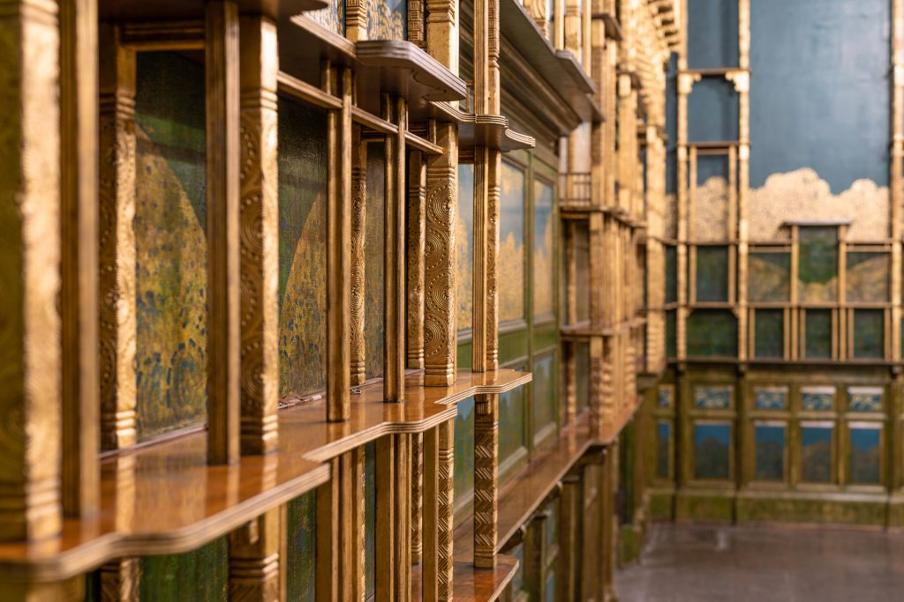

文件 [images/peacock-shelves.jpg](images/peacock-shelves.jpg)。

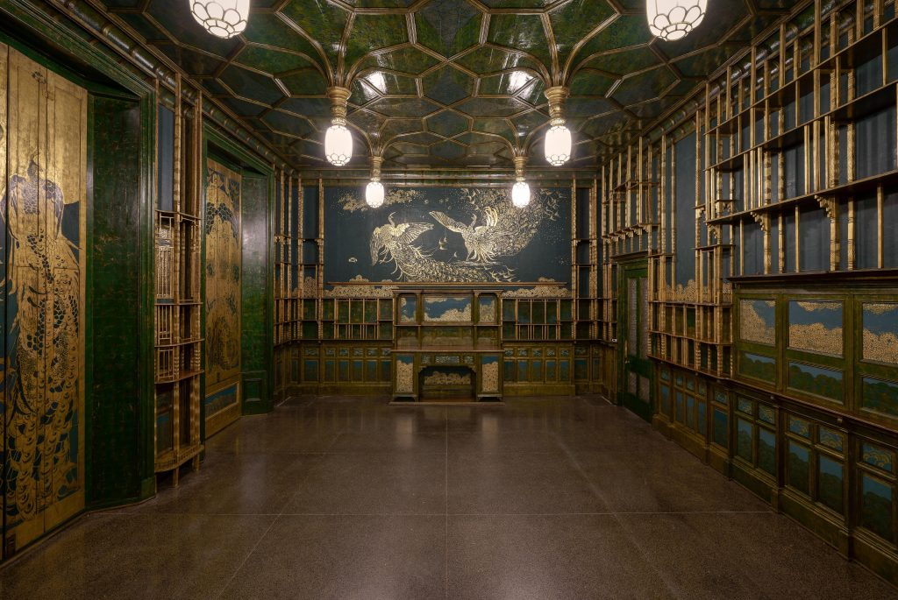

文件 [images/peacock-south-wall.jpg](images/peacock-south-wall.jpg)。

图片版权与署名按来源页面保留。此目录用于项目参考研究，未把馆方照片或数字复制件统一标为CC0。
